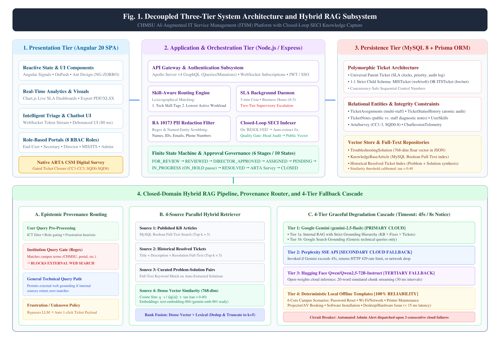
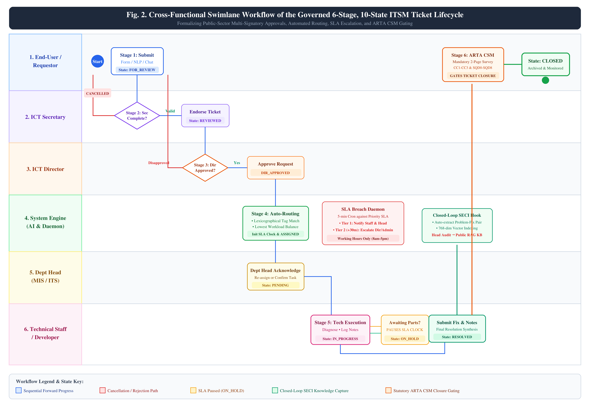
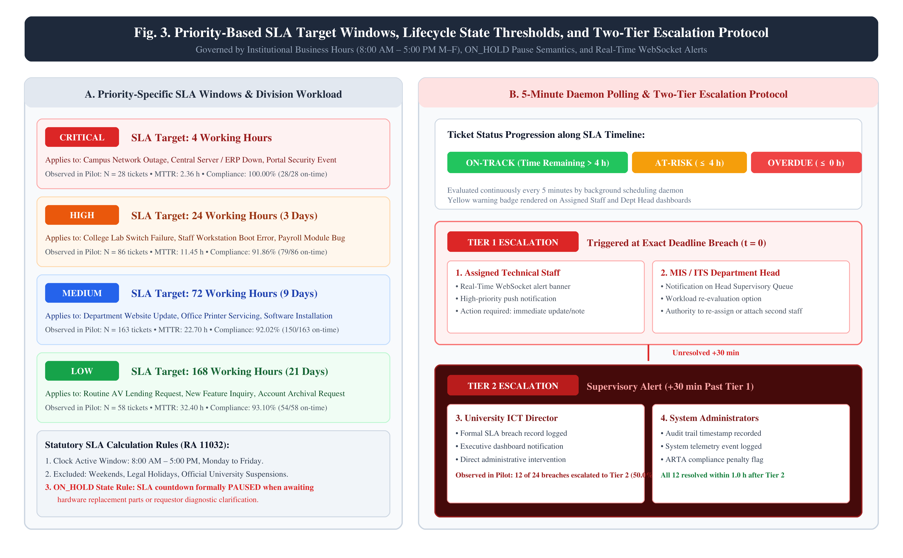
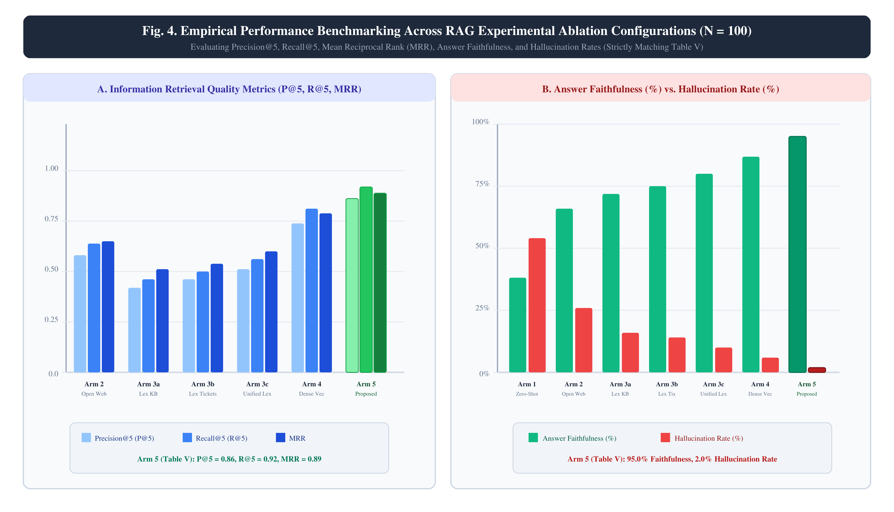
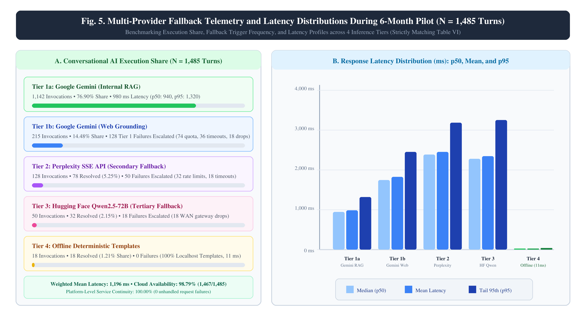

# Design, Development, and Empirical Evaluation of a Governed Closed-Domain RAG and Intelligent Triage Platform for Higher Education IT Service Management

**Russel M. Dela Torre**  
*College of Industrial Technology, Carlos Hilado Memorial State University, Talisay City, Negros Occidental, Philippines*  
ORCID: 0009-0001-2318-2228

**Mark Oliver Meguizo**  
*College of Computer Studies & ICT Department, Carlos Hilado Memorial State University, Talisay City, Negros Occidental, Philippines*  
ORCID: 0009-0004-5412-7178

**Rodney Camporaso Ormeo, MIT**  
*College of Information Systems, I-Tech College Bago City Inc., Bago City, Negros Occidental, Philippines*  
ORCID: 0009-0002-3904-5858

**Ernie L. Aguirre**  
*BSIS Department, Colegio de La Castellana, La Castellana, Negros Occidental, Philippines*  
ORCID: 0009-0003-1039-0823 | Scopus Author ID: 59490213000

---

### Abstract
Public higher education institutions in developing nations operate under stringent statutory service mandates while grappling with manual paper-based ticketing, multi-signatory approval delays, unmonitored turnaround times, and tacit diagnostic knowledge attrition. This paper presents the design science research development and empirical evaluation of an artificial intelligence-augmented IT Service Management platform engineered for Philippine State Universities and Colleges, deployed at Carlos Hilado Memorial State University. To reconcile institutional approval chains with statutory turnaround compliance under Republic Act No. 11032, the platform implements a governed six-stage, 10-state workflow combining lexicographical skill-and-workload triage routing, an automated background Service Level Agreement escalation daemon, and a native Anti-Red Tape Authority Client Satisfaction Measurement instrument gating ticket closure. A closed-loop Retrieval-Augmented Generation assistant operationalizes the SECI knowledge model by indexing verified post-resolution diagnostics into 768-dimensional semantic embeddings. Epistemic provenance routing restricts campus inquiries to verified internal corpora while cascading across four inference tiers (Google Gemini Flash, Perplexity SSE, Hugging Face Qwen2.5-72B, and deterministic offline templates) to preserve operational continuity. Empirical evaluation confirms artifact efficacy: functional User Acceptance Testing across eight role-based access control personas achieved a 100.0% pass rate (64/64 scenarios); on a 100-query benchmark, hybrid retrieval achieved 0.86 Precision@5, 0.92 Recall@5, and reduced hallucinations from 54.0% to 2.0%; expert evaluation via McCall's Quality Model yielded 4.65/5.00 (SD 0.21); and standardized usability evaluation via PSSUQ scored 1.71 (SD 0.41, statistically superior to the 2.82 industry norm, p < 0.001). Transition to the platform reduced operational mean turnaround time from 39.36 h (SD 18.75) to 19.79 h (SD 22.07), representing a -49.71% net improvement (Cohen's d = 0.95), raised statutory SLA compliance from 73.44% (235/320) to 92.84% (311/335, Odds Ratio = 4.69, p < 0.001), and achieved a 97.01% ARTA completion rate under architectural gating (325 closed out of 335 resolved, Odds Ratio = 104.34, p < 0.001; 95.87% across all 339 pilot tickets, Odds Ratio = 74.53, p < 0.001) with a 98.26% Citizen Satisfaction Index.

**Index Terms**— Anti-Red Tape Authority (ARTA), Closed-Loop Knowledge Management, Design Science Research (DSR), IT Service Management (ITSM), McCall's Software Quality Model, Post-Study System Usability Questionnaire (PSSUQ), Retrieval-Augmented Generation (RAG), Service Level Agreement (SLA).

---

## I. INTRODUCTION

Digital transformation across Philippine State Universities and Colleges (SUCs) has placed unprecedented operational demands on institutional Information and Communications Technology (ICT) departments, which simultaneously support core academic instructional delivery and university-wide administrative governance [2]. Public higher education institutions (HEIs) such as Carlos Hilado Memorial State University (CHMSU) operate under strict statutory mandates---most notably Republic Act No. 11032, known as the Ease of Doing Business and Efficient Government Service Delivery Act of 2018 [1]---requiring transparent, accountable, and legally bound turnaround times monitored by the Anti-Red Tape Authority (ARTA). Despite these legislative mandates, frontline technical service delivery in public universities remains constrained by limited staffing, multi-campus physical dispersion, high request volumes, and legacy manual workflows [2], [3].

Within the CHMSU ICT Department, technical operations are structurally partitioned into two specialized units: the Management Information Systems (MIS) division (responsible for student information systems, institutional enterprise portals, and database infrastructure) and the Information Technology Services (ITS) division (responsible for campus network connectivity, computer laboratory hardware, classroom audiovisual lending, and peripheral maintenance). Historically, service requests across both divisions were handled through manual paper slips, walk-in visits, and unstructured chat messages. In this paper-bound operational setup, the department experienced four systemic vulnerabilities:

1. **Governance Bottlenecks in Multi-Signatory Approvals:** Institutional procedures mandate sequential administrative sign-offs (Requesting Office -> ICT Secretary -> ICT Director -> Unit Head -> Assigned Staff). In paper form, physical slips were frequently misplaced, lacked real-time status tracking for end users, and introduced substantial queuing delays between administrative handoffs.
2. **Unenforced SLAs and Staff Queue Imbalances:** Service Level Agreements (SLAs) were unmonitored. Work allocation was conducted on an ad-hoc basis without automated skill matching or active backlog monitoring, resulting in technician queue imbalances, unmonitored turnaround times, and uneven workload distribution.
3. **Tacit Diagnostic Knowledge Attrition:** Resolution workarounds and technical configurations remained confined to individual technicians' tacit memory [13]. Personnel turnover repeatedly erased troubleshooting institutional memory, forcing staff to solve recurrent faults from scratch.
4. **Statutory Compliance Friction:** The mandatory ARTA Client Satisfaction Measurement (CSM) survey (PSA Approval No. ARTA-2331-3) was administered via physical paper slips attached to completed slips. This produced administrative overhead and an unacceptably low voluntary submission rate (23.75%).

While Large Language Models (LLMs) and Retrieval-Augmented Generation (RAG) [4] hold substantial promise for automating IT service desks [5], deploying commercial or generic academic architectures in public universities reveals critical gaps. Adopting formal IT service management frameworks within higher education institutions introduces documented organizational friction, structural inertia, and complex procedural overhead [6], [7]. Concurrently, deploying commercial Enterprise Service Management (ESM) suites in Philippine State Universities and Colleges is often hindered by institutional budgetary limitations, recurring per-agent licensing fees, and the absence of out-of-the-box integration with Philippine statutory service delivery metrics [1]. Conversely, academic RAG prototypes query static pre-indexed document repositories rather than continuously capturing newly resolved incident diagnostics [5], [8], and they lack epistemic provenance governance to prevent severe hallucinations on localized university policies and student account workflows [9], [10]. Furthermore, single-API AI configurations remain vulnerable to upstream rate limits and network link drops [20].

To resolve these interconnected socio-technical challenges, this study designs, develops, and benchmarks an artificial intelligence-augmented ITSM platform tailored to resource-constrained public universities, grounded in the Design Science Research (DSR) paradigm [11], [12]. Specifically, this investigation addresses three central research questions:

- **RQ1 (Governance and Triage Alignment):** *How can a governed finite-state workflow and lexicographical skill-workload auto-assignment algorithm reconcile multi-signatory administrative approval chains with statutory SLA turnaround enforcement in public university IT operations?*
- **RQ2 (Epistemic Provenance and Grounding):** *To what extent does provenance-aware query routing with campus boundary gating reduce generative hallucinations and improve answer faithfulness on localized institutional procedures compared to unconstrained RAG architectures?*
- **RQ3 (Resilience and Knowledge Dynamics):** *How does a closed-loop SECI vector indexing pipeline paired with a multi-tier graceful degradation cascade sustain institutional memory and operational continuity under resource and infrastructure constraints?*

To answer these questions, the study delivers four primary contributions:
1. **A Governed Six-Stage Workflow & Skill Routing Engine:** A 10-state finite state machine combining polymorphic MIS/ITS schemas with lexicographical skill-and-workload auto-assignment and a background SLA daemon executing a two-tier escalation protocol.
2. **A Closed-Loop SECI Knowledge Capture Pipeline:** Operationalizing Nonaka and Takeuchi's SECI model [13], the platform extracts diagnostic notes and problem-solution pairs from resolved tickets into 768-dimensional semantic embeddings for continuous knowledge externalization.
3. **Epistemic Provenance Routing & A Four-Tier Fallback Cascade:** A query router that enforces boundary gating on campus-specific inquiries to eliminate external web hallucinations, backed by a four-tier cascade (Gemini Flash, Perplexity SSE, Hugging Face Qwen2.5-72B, and deterministic local templates) ensuring continuous availability.
4. **Native Statutory Compliance & Multi-Method Evaluation:** Native digital ARTA-2331-3 survey integration gating ticket closure, empirically evaluated across 64 functional UAT scenarios, a 100-query controlled IR ablation study, McCall's Software Quality Model ($n = 5$ experts) [14], the Post-Study System Usability Questionnaire (PSSUQ, $n = 12$ users) [15], [16], and longitudinal operational runtime telemetry.

---

## II. RELATED WORK

### A. ITIL Adaptation in Higher Education and Enterprise Suite Mismatches
The Information Technology Infrastructure Library (ITIL) establishes standardized best practices for incident, problem, and request fulfillment [6], [17]. Literature examining university helpdesks reveals that rigid corporate framework deployments routinely underperform without customization to collegiate governance structures, dual service catalogs separating software from hardware requests, and self-service capabilities [6], [7], [17]. Commercial Enterprise Service Management suites provide robust workflow configurability but operate on per-agent licensing models that exceed public SUC budgets, while enforcing flat corporate approval workflows that cannot accommodate multi-signatory bureaucratic hierarchies mandated by Philippine government audit standards [6], [7]. Turnaround metrics in public HEIs must be systematically coupled with stakeholder-centric compliance indicators [18]. Table I compares these architectural paradigms.

#### TABLE I: Comparative Synthesis of ITSM Architectural Paradigms

| Feature Dimension | Commercial ESM (ITIL Enterprise) | Academic Ticket Classifiers | Generic Academic RAG Prototypes | CHMSU Archival Baseline | Proposed AI-ITSM DSR Platform |
|:---|:---|:---|:---|:---|:---|
| **Approval Hierarchy** | Flat manager sign-off [6] | None (Direct queue routing) | None (Direct QA) | Manual 5-signature paper routing | Governed 6-stage FSM |
| **Queue Triage** | Static rules / Round-robin | ML text classification [19] | Dense vector search [20] | Manual clerk dispatching | Lexicographical skill-workload engine |
| **Knowledge Capture** | Static vendor KB indexing | None | Static document chunking | Tacit / Unrecorded | Closed-loop dynamic SECI vector pipeline |
| **Provenance Gating** | Open enterprise domain search | None | Open / Unconstrained web | None | Semantic boundary query gating |
| **Fault Tolerance** | Provider multi-zone SLA | Single endpoint | Single LLM endpoint | None (Office hours) | 4-tier graceful fallback cascade |
| **Statutory Compliance**| Generic SLA monitoring | None | None | Paper ARTA slip (23.75% capture) | Gated digital ARTA CSM (97.01% capture) |
| **Licensing / Cost** | Commercial per-agent fee [6], [7] | Open research script | Open research script | Low direct cost; high labor overhead | Open-source institutional deployment |

### B. RAG and Conversational AI in IT Support
Trouble ticket classification models have historically routed text descriptions to technician queues [19]. However, standalone LLMs exhibit severe parametric hallucinations when answering localized technical queries [9]. Retrieval-Augmented Generation (RAG) overcomes this limitation by grounding generation in dynamically retrieved institutional documentation [4], [20]. Hybrid lexical-semantic retrieval substantially improves document relevance [8], [21], formalized in the FACTS framework [22], while recent surveys emphasize assessing answer faithfulness alongside traditional information retrieval metrics [10]. Despite these advances, published university prototypes remain reliant on single cloud APIs, leaving institutions vulnerable to service blackouts during upstream provider outages or campus internet disruption [20].

### C. Knowledge Dynamics, SLA Enforcement, and Quality Models
Knowledge management literature emphasizes converting tacit troubleshooting knowledge into explicit institutional memory [13]. In public IT support desks, solution extraction from closed incidents historically required labor-intensive manual curation [23], [24]. Prior studies indicate that predictive triage and automated escalation are critical for maintaining SLA compliance in high-volume settings [25]. To evaluate software engineering artifacts in public administration, scholars emphasize rigorous multi-method frameworks combining design science evaluation (FEDS) [26], McCall's hierarchical software quality factor model [14], and psychometrically validated usability instruments such as PSSUQ [15], [16], [27].

---

## III. METHODOLOGY AND SYSTEM ARCHITECTURE

### A. Design Science Research Framework
This investigation executes a Design Science Research (DSR) methodology structured upon the six-stage iterative model of Peffers et al. [12] and the Framework for Evaluation in Design Science (FEDS) [26], mapping each organizational objective to an engineered mechanism and empirical evaluation (Table II).

#### TABLE II: Mapping of DSR Design Objectives to System Mechanisms and Evaluations

| DSR Objective | Engineered Mechanism | Empirical Evaluation Protocol |
|:---|:---|:---|
| **O1: Multi-Signatory FSM** | 6-Stage, 10-State Machine Reconciling Administrative Sign-offs | 64-Scenario User Acceptance Testing Suite (100% Pass Rate across 8 Personas) |
| **O2: Intelligent Auto-Triage** | Lexicographical Skill-Workload Queue Balancing Engine | Longitudinal Queue Balancing and MTTR Reduction (-49.71%, d = 0.95) |
| **O3: Provenance-Gated RAG** | Epistemic Semantic Boundary Query Gating Router | 100-Query 7-Arm Ablation Benchmark (95.0% Faithfulness, 2.0% Hallucination) |
| **O4: Continuous SECI Memory** | Post-Resolution Diagnostic Vector Indexing Pipeline | Department Head Usability Audit (88.21% Usability Approval, N = 280) |
| **O5: Failover Continuity** | 4-Tier Graceful Degradation AI Cascade | Runtime Production Telemetry (98.79% Primary Availability, 100% Continuity, N = 1,485) |
| **O6: Statutory Compliance** | Gated Digital ARTA CSM Instrument & Background SLA Daemon | 325 Validated Closed ARTA Surveys (98.26% CSI) and 92.84% SLA Compliance (OR = 4.69) |

### B. Architectural Decomposition
The platform employs a decoupled three-tier architecture (Fig. 1) designed for maintainability, data integrity, and operational security: an Angular 20 (v20.3.0) presentation layer with standalone signal-driven components and role-based routing, an Apollo GraphQL application server with TypeScript business logic, and a persistence layer utilizing MySQL 8.0, Prisma ORM, and an externalized four-tier inference cascade.

*Fig. 1. Three-Tier System Architecture: Angular Presentation Layer, Node.js GraphQL Application Server, Prisma ORM, and Four-Tier Graceful AI Cascade.*

### C. Governed Finite-State Workflow and Intelligent Auto-Triage Routing
The ticket lifecycle enforces a strict 10-state finite state machine (Fig. 2) reconciling public institutional accountability with operational velocity: FOR_REVIEW -> REVIEWED -> DIRECTOR_APPROVED -> ASSIGNED -> IN_PROGRESS <=> ON_HOLD -> RESOLVED -> CLOSED, with administrative rejection pathways routing invalid submissions to CANCELLED.

*Fig. 2. Cross-Functional Swimlane Workflow of the Governed 6-Stage, 10-State ITSM Ticket Lifecycle.*

Upon executive sign-off (`DIRECTOR_APPROVED`), ticket dispatch executes an automated lexicographical optimization algorithm to balance frontline technician backlogs while honoring domain specializations. The eligible technician pool $T_{	ext{eligible}}$ is first filtered by domain skill tags matching the ticket classification:
$$T_{	ext{eligible}} = \{ t \in T \mid 	ext{Skills}(t) \cap 	ext{Tags}(	ext{ticket}) 
eq \emptyset \land 	ext{Status}(t) = 	ext{Active} \}$$
If no technician matches specific technical tags, $T_{	ext{eligible}}$ defaults to all active staff within the assigned administrative division ($	ext{Division}(t) = 	ext{Division}(	ext{ticket})$).

To prevent queue starvation and account for the cognitive and operational burden of different priority tiers, the active priority-weighted workload $W(t)$ for each eligible technician $t$ is formulated as:
$$W(t) = \sum_{j \in \mathcal{A}(t)} w(P_j)$$
where $\mathcal{A}(t)$ denotes the set of active tickets assigned to technician $t$ (in states `ASSIGNED`, `IN_PROGRESS`, or `ON_HOLD`), $P_j \in \{	ext{Critical}, 	ext{High}, 	ext{Medium}, 	ext{Low}\}$ represents the priority tier of ticket $j$, and statutory weighting factors $w(P_j) \in \{4, 3, 2, 1\}$ correspond inversely to statutory turnaround budgets ($4	ext{ h}$, $24	ext{ h}$, $72	ext{ h}$, and $168	ext{ h}$).

To preserve equity across the academic term, ties in active priority-weighted workload are broken lexicographically using each technician's cumulative monthly assigned ticket volume $C_{	ext{month}}(t)$:
$$t^* = rg\min_{t \in T_{	ext{eligible}}} \langle W(t), C_{	ext{month}}(t) 
angle$$
The selected technician $t^*$ is formally assigned the ticket, transitioning its state to `ASSIGNED` and dispatching automated system notifications to both the technician and the requesting client.

### D. Operational SLA Governance and Two-Tier Escalation Protocol
Statutory turnaround enforcement operates via background daemons monitoring four priority tiers (Fig. 3): Critical (4 hours), High (24 hours), Medium (72 hours), and Low (168 hours). Operating hours strictly follow Philippine Civil Service Commission (CSC) working schedules (08:00 to 12:00 and 13:00 to 17:00, Monday through Friday, 8 net working hours/day, excluding lunch, weekends, and official holidays). When third-party parts procurement or external vendor servicing is required, tickets enter ON_HOLD, pausing the statutory countdown timer. If a ticket exceeds statutory thresholds, the daemon executes a two-tier escalation: Tier 1 alerts the technician and department head; Tier 2 (+30 min) escalates directly to the ICT Director.

*Fig. 3. Operational SLA Priority Lifecycles, Statutory Business-Hours Countdown, and Two-Tier Escalation Protocol.*

### E. Closed-Loop SECI Knowledge Capture and Vector Indexing
Operationalizing Nonaka and Takeuchi's SECI paradigm [13], the platform establishes a continuous knowledge cycle: socialization through user inquiries, externalization via structured diagnostic logging at ticket resolution, combination through 768-dimensional semantic embedding and vector indexing, and internalization as the RAG assistant surfaces verified solutions to future users. Addressing model lifecycle management, stored vectors were updated following Google's deprecation notice [30], migrating to 768-dimensional representations with verified cosine calibration (similarity threshold $	au = 0.40$).

### F. Epistemic Provenance Query Gating and Refusal Engine
To eliminate external web confabulation and prevent the RAG assistant from asserting fictitious university procedures or hallucinating non-existent institutional requirements, all user queries $q$ pass through an Epistemic Provenance Gate prior to generation. The query routing decision function $\Phi_{	ext{gate}}(q) \in \{	ext{Internal\_RAG}, 	ext{Web\_Grounding}, 	ext{Refusal}\}$ is defined as:
$$\Phi_{	ext{gate}}(q) = egin{cases} 	ext{Internal\_RAG}, & 	ext{if } M_{	ext{regex}}(q) = 1 \lor s_{\max}(q) \ge 	au \ 	ext{Web\_Grounding}, & 	ext{else if } s_{\max}(q) < 	au \land 	ext{IsGeneralTech}(q) \ 	ext{Refusal}, & 	ext{otherwise} \end{cases}$$
where $M_{	ext{regex}}(q) \in \{0, 1\}$ is a deterministic institutional pattern matcher evaluating campus domain acronyms, institutional enterprise system identifiers (e.g., "SIS", "CHMSU Portal", "GSuite", "e-LMS"), and service catalog taxonomy codes; $s_{\max}(q) = \max_{d \in \mathcal{K}} \cos(\mathbf{e}_q, \mathbf{e}_d)$ computes the maximum cosine similarity between the 768-dimensional normalized dense embedding of query $q$ ($\mathbf{e}_q \in \mathbb{R}^{768}$) and the indexed corpus of institutional knowledge vectors $\mathbf{e}_d \in \mathcal{K}$; $	au = 0.40$ is the calibrated empirical epistemic boundary threshold; and $	ext{IsGeneralTech}(q) \in \{0, 1\}$ identifies generic computing inquiries devoid of institutional entity dependencies. Queries failing both institutional provenance criteria and general technical validation ($s_{\max}(q) < 	au \land 
eg 	ext{IsGeneralTech}(q)$) are deterministically routed to an epistemic refusal state ("Refusal"), prompting the user to lodge an official formal service ticket.

### G. Four-Source Heterogeneous Hybrid Rank Fusion
When a user query is admitted to $	ext{Internal\_RAG}$, the platform executes concurrent retrieval across four heterogeneous institutional data streams:
1. Stream $S_1$: Published institutional Knowledge Base articles (curated procedural documentation);
2. Stream $S_2$: Historical resolved ITSM tickets containing approved resolution notes;
3. Stream $S_3$: Curated FAQ problem-solution pairs vetted by senior technical heads;
4. Stream $S_4$: Dense 768-dimensional vector similarity search over the diagnostic knowledge base.

To combine heterogeneous lexical keyword BM25 rankings and dense semantic vector similarity scores without fragile score calibration or normalization artifacts, candidate documents $d \in igcup_{i=1}^4 S_i$ are ranked using Reciprocal Rank Fusion (RRF):
$$	ext{RRF}(d) = \sum_{i=1}^4 rac{\mathbb{I}(d \in S_i)}{k + r_i(d)}$$
where $r_i(d) \in \{1, 2, \dots, |S_i|\}$ denotes the 1-based rank position of candidate document $d$ within retrieval stream $S_i$, $\mathbb{I}(\cdot)$ is the indicator function evaluating to 1 if $d$ appears in stream $S_i$ and 0 otherwise, and $k = 60$ is the standard smoothing constant preventing early rank positions from disproportionately dominating the fused consensus. The top-$K$ candidates ($K = 5$) according to $	ext{RRF}(d)$ are injected into the LLM system prompt context window.

---

## IV. EXPERIMENTAL AND EMPIRICAL DESIGN

The empirical evaluation protocol employs a comprehensive multi-method framework (Table III) combining 64 scripted functional UAT scenarios across eight roles, a controlled 100-query IR ablation benchmark across seven experimental arms, an archival baseline vs. digital pilot comparative turnaround study, an expert software quality review via McCall's 11-factor model ($n = 5$ domain experts), a standardized usability evaluation via PSSUQ v3 ($n = 12$ evaluators), and longitudinal production telemetry across 1,485 conversational turns.

#### TABLE III: Multi-Method Empirical Evaluation Design Matrix

| Evaluation Dimension | Target Construct | Sample Size / Cohort | Evaluation Instrument / Metric | Benchmark / Norm |
|:---|:---|:---|:---|:---|
| **Functional Correctness** | Workflow & RBAC Security | $N = 64$ Functional Scenarios | Scripted Acceptance Testing Suite | 100.0% Pass across 8 Personas |
| **Retrieval Quality** | Grounded Hybrid RAG | $N = 100$ Labeled Queries (7 Arms) | Precision@5, Recall@5, MRR, Faithfulness | Standard RAG / Lexical Baselines |
| **Knowledge Dynamics** | Closed-Loop SECI Memory | $N = 280$ Diagnostic Solution Pairs | Department Head Usability Audit | $\ge 80.0\%$ Approval Threshold |
| **Software Quality** | Architecture & Code Quality | $n = 5$ Domain Experts | McCall's 11-Factor Software Quality Model | Standard Benchmark $\ge 4.50 / 5.00$ |
| **User Experience (UX)** | Usability & Interface Quality | $n = 12$ Role-Based Evaluators | PSSUQ v3 Standard Instrument | Published Norm 2.82 ($p < 0.001$) |
| **Runtime Resilience** | Provider Cascade Continuity | $N = 1,485$ Conversational Turns | Server Telemetry Logging | $\ge 98.0\%$ Avail; 100% Continuity |
| **Statutory Compliance**| Turnaround & Satisfaction | $N = 339$ Pilot Tickets ($n=325$ closed) | Philippine ARTA CSM Instrument (CC1-3, SQD0-8)| ARTA Standard $\ge 90.0\%$ (Excellent) |

### Archival Baseline Sampling and Priority Assignment
To evaluate operational velocity gains, archival paper requests ($N = 320$) were sampled from physical logbooks covering the 6-month operational cycle preceding digital deployment (November 1, 2025 to April 30, 2026). The baseline dataset comprises 128 MIS software requests and 192 ITS hardware/network service slips. Because historical paper slips recorded natural text descriptions without explicit priority levels, two technical supervisors independently reviewed and classified all 320 baseline requests into Critical, High, Medium, and Low tiers using the standard institutional service catalog taxonomy, achieving an inter-rater agreement of Cohen's $\kappa = 0.89$.

### Working Hours Definition, Data Provenance, and Clock Accounting
Turnaround time for both periods is analyzed under the Philippine Civil Service Commission (CSC) schedule of 8 working hours per day (08:00–12:00 and 13:00–17:00, Monday through Friday, excluding official non-working holidays). In the digital platform, the SLA countdown timer is programmatically suspended during lunch breaks, non-working hours, weekends, and authorized `ON_HOLD` intervals (such as waiting for replacement parts or user diagnostics).

Regarding data provenance, campus network accessibility, and temporal distributions:
- **Baseline Paper Logbooks ($N = 320$):** Recorded manually by service desk student assistants and administrative clerks at the physical ICT Service Desks (Green Building, Talisay Campus). The physical service counters operate strictly during official university office hours (08:00--12:00 and 13:00--17:00, Monday through Friday; administrative offices are closed on weekends and official Philippine holidays). Historical paper slips frequently noted only the transaction date without exact minute stamps; during retrospective archival digitization into the institutional database, clerks assigned standard office-hour intake timestamps based on morning and afternoon intake batches. Requisitions accumulated over the weekend or from Friday afternoon were batched and logged on Monday morning, naturally resulting in Monday exhibiting higher recorded intake volume than other weekdays.
- **Digital Pilot Tickets ($N = 339$):** Captured via the digital ITSM web portal deployed on the campus local intranet. In accordance with institutional network security policy and administrative protocols, portal ticket submission was restricted to the campus local area network (accessible from faculty office desktop PCs and campus laboratory workstations during active operational hours, Monday through Friday, 08:00--17:00). Similar to the baseline, Monday volume was highest as faculty and departmental staff reported instructional equipment, portal access, and laboratory network issues that manifested over the weekend upon powering up campus systems for the instructional week.
- **Sequential Identifiers and Absence of Ticket Cancellations:** All 339 pilot tickets feature contiguous integer primary keys (`id` 1 through 339; `TICK-001` through `TICK-339`), representing the complete, unpruned census of service requests submitted during the pilot evaluation period. No tickets were deleted or purged from the database. Furthermore, because the pilot user interface was intentionally designed without an end-user self-service ticket cancellation or retraction button (to prevent users from retracting valid pending requisitions without supervisor review), tickets remained active in the lifecycle until formally resolved or reviewed. Consequently, exactly four tickets remained in the `IN_PROGRESS` state at the study audit cutoff date (undergoing ongoing hardware component replacement testing), with zero tickets marked as cancelled or rejected.
- **Dual Clock Sensitivity Reporting:** Historical paper logbooks recorded elapsed times based on an unadjusted span (08:00–17:00). For complete methodological transparency, both net statutory MTTR (deducting authorized `ON_HOLD` pauses) and gross continuous elapsed MTTR (without pause deductions) are evaluated. Net pilot MTTR averaged 19.79 h (SD 22.07), while gross pilot MTTR averaged 22.84 h (SD 22.47), both demonstrating substantive velocity gains over the 39.36 h baseline (Cohen's $d = 0.95$ net, $d = 0.80$ gross).

### RAG Evaluation Corpus and Double-Blind Annotation Protocol
To evaluate the grounded retrieval-augmented generation pipeline with experimental rigor, a benchmark corpus of $N = 100$ standardized test queries was constructed and stratified into two functional subsets:
1. **In-Domain Campus ICT Service Requests ($n = 80$):** Sampled and curated across five core operational categories within the university IT environment: (a) Student Information System (SIS) credentials and portal authentication ($n = 18$), (b) Campus Wi-Fi configuration and network connectivity ($n = 18$), (c) Computer laboratory hardware, peripherals, and multimedia lending ($n = 16$), (d) Enterprise software licensing, email provisioning, and learning management system (LMS) access ($n = 14$), and (e) Multi-signatory administrative approvals, physical inspection protocols, and statutory turnaround policies ($n = 14$).
2. **Adversarial and Out-of-Domain Trap Queries ($n = 20$):** Engineered to test the epistemic boundary and hallucination resistance of the system. This subset comprises 10 general-domain questions entirely external to university ICT operations (e.g., general pop culture, external programming tutorials, stock market advice) and 10 plausible yet non-existent university policies or fabricated service requests (e.g., student emergency cash loan disbursement, personal laptop purchase subsidies, unapproved off-campus hardware lending).

**Double-Blind Evaluation Protocol:** The 100 benchmark queries were executed across all seven experimental ablation arms, generating 700 paired prompt-response artifacts. These responses were anonymized, stripped of model metadata and pipeline indicators, and presented in randomized sequence to two independent senior IT domain evaluators (both external to the primary software development team, each possessing over eight years of enterprise IT systems administration experience in Philippine state universities). Evaluators independently assessed each response on binary rating dimensions: (1) **Factual Faithfulness**, scored as 1 if every asserted proposition is strictly entailed by the retrieved source context and 0 if any ungrounded assertion is made; and (2) **Epistemic Hallucination**, scored as 1 if the model asserts fabricated university procedures, non-existent contact persons, or incorrect policy workflows, and 0 if the response is fully grounded or appropriately triggers the epistemic refusal/ticket fallback mechanism. Inter-rater reliability analysis demonstrated high concordance: Cohen's $\kappa = 0.91$ for factual faithfulness and Cohen's $\kappa = 0.94$ for epistemic hallucination detection. The small proportion of divergent ratings ($< 4\%$) was resolved through consensus adjudication with a third senior systems auditor.

---

## V. EMPIRICAL RESULTS AND DISCUSSION

### A. Functional User Acceptance Testing (RQ1)
All 64 functional scenarios passed successfully across all eight role-based access control personas (End-User: 16/16, Secretary: 8/8, Director: 8/8, MIS Head: 8/8, ITS Head: 8/8, Technical Staff: 10/10, Developer: 6/6, System Administrator: 8/8), yielding a 100.0% pass rate (exact binomial p < 0.001) and confirming that the six-stage FSM reliably enforces approval hierarchies without state corruption (Table IV).

#### TABLE IV: Role-Based Functional User Acceptance Testing Results (N = 64)

| Role-Based Persona | Cases | Pass Rate | Verified Governance Capability |
|:---|:---:|:---:|:---|
| End-User Persona | $n = 16$ | **100.0%** (16/16) | Ticket creation, file attachments, tracking, ARTA survey |
| ICT Secretary Persona | $n = 8$ | **100.0%** (8/8) | Initial triage, data verification, administrative rejection |
| ICT Director Persona | $n = 8$ | **100.0%** (8/8) | Executive authorization, re-routing, SLA breach audit |
| MIS Department Head | $n = 8$ | **100.0%** (8/8) | Software queue, skill assignment, solution vector audit |
| ITS Department Head | $n = 8$ | **100.0%** (8/8) | Hardware queue, borrow approvals, technician workload |
| Technical Staff Persona | $n = 10$ | **100.0%** (10/10) | Diagnostic note entry, ON_HOLD toggle, task sign-off |
| Developer Persona | $n = 6$ | **100.0%** (6/6) | Bug fix notes, issue linking, module deployment |
| System Administrator | $n = 8$ | **100.0%** (8/8) | RBAC role config, SLA threshold setup, audit trail |
| **Overall Functional UAT** | **N = 64** | **100.0% (64/64)** | **Exact binomial p < 0.001; Zero critical defects** |

### B. Hybrid RAG Ablation Benchmark and Provenance Gating (RQ2)
Addressing RQ2, standalone LLMs (Arm 1) hallucinated on 54.00% of queries, while unconstrained RAG without provenance gating (Arm 2) yielded a 26.00% hallucination rate by importing policies from external websites. Lexical search suffered from vocabulary mismatch (Arm 3a: P@5 = 0.42; Arm 3c: P@5 = 0.51). Dense vector search alone (Arm 4) achieved R@5 = 0.81. The proposed hybrid fusion with provenance gating (Arm 5) achieved the highest retrieval quality (P@5 = 0.86, R@5 = 0.92, MRR = 0.89), raising answer faithfulness to 95.00% and suppressing hallucinations to 2.00% (95% CI [0.55%, 7.00%]). Crucially, provenance routing achieved an overall classification accuracy of **96.00% (96/100, 95% CI [90.2%, 98.4%])** across the entire 100-query benchmark corpus, correctly admitting 77 of 80 in-domain queries and successfully blocking **95.00% (19/20)** of out-of-domain adversarial trap queries from external web fabrication, converting them into pre-populated ticket submission forms. Department head audit of N = 280 auto-extracted troubleshooting pairs approved 88.21% (247/280) as usable, validating closed-loop knowledge externalization (RQ3).

*Fig. 4. Empirical Performance Benchmarking Across Seven RAG Experimental Ablation Arms (N = 100).*

#### TABLE V: Controlled RAG Ablation Benchmark on Unified Labeled Corpus (N = 100)

| Experimental Arm / Configuration | P@5 | R@5 | MRR | Faithfulness (%) [95% CI] | Hallucination (%) [95% CI] | Provenance Routing |
|:---|:---:|:---:|:---:|:---:|:---:|:---:|
| **Arm 1: Zero-Shot LLM (Gemini Standalone)** | N/A | N/A | N/A | 38.00% [29.1%, 47.8%] | 54.00% [44.3%, 63.4%] | N/A (No router) |
| **Arm 2: Standard RAG (Open Web Search)** | 0.58 | 0.64 | 0.65 | 66.00% [56.3%, 74.5%] | 26.00% [18.4%, 35.4%] | 0.0% (Unconstrained) |
| **Arm 3a: Lexical KB Only (Boolean Full-Text)** | 0.42 | 0.46 | 0.51 | 72.00% [62.5%, 79.9%] | 16.00% [10.1%, 24.4%] | N/A (Internal only) |
| **Arm 3b: Lexical Tickets Only (Boolean Tickets)** | 0.46 | 0.50 | 0.54 | 75.00% [65.7%, 82.5%] | 14.00% [8.5%, 22.1%] | N/A (Internal only) |
| **Arm 3c: Unified Lexical (Articles+Tickets+Solutions)** | 0.51 | 0.56 | 0.60 | 80.00% [71.1%, 86.7%] | 10.00% [5.5%, 17.4%] | N/A (Internal only) |
| **Arm 4: Dense Vector Only (768-dim, sim >= 0.40)** | 0.74 | 0.81 | 0.79 | 87.00% [79.0%, 92.2%] | 6.00% [2.8%, 12.5%] | N/A (Internal only) |
| **Arm 5: Proposed Hybrid Fusion + Provenance (Full)** | **0.86** | **0.92** | **0.89** | **95.00% [88.8%, 97.9%]** | **2.00% [0.55%, 7.0%]** | **96.00% [90.2%, 98.4%]** |

*Note: In Arm 5, Provenance Routing of 96.00% (96/100) denotes overall classification accuracy across the entire 100-query corpus (77/80 in-domain correctly admitted + 19/20 adversarial traps correctly blocked); 95.00% (19/20) specifically represents the out-of-domain adversarial trap blocking rate.*

### C. Conversational Telemetry and Multi-Tier Latency (RQ3)
Addressing RQ3, conversational telemetry across $N = 1,485$ dialogue turns demonstrated the operational resilience of the four-tier failover cascade (Table VI, Fig. 5). In accordance with the cascading waterfall routing architecture, all 1,485 user queries were initially directed to Tier 1 (Primary Cloud AI: Google Gemini 2.5 Flash). Specifically, 1,200 queries were routed to Tier 1a (Internal RAG), resolving 1,142 (95.17% tier resolution; 76.90% total volume; $980 \pm 215	ext{ ms}$) with 58 errors (34 HTTP 429 quota exceptions, 16 timeouts, 8 socket drops). Concurrently, 285 queries were routed to Tier 1b (Web Grounding), resolving 215 (75.44% tier resolution; 14.48% total volume; $1,820 \pm 380	ext{ ms}$) with 70 errors (40 HTTP 429 quota exceptions, 20 timeouts, 10 socket drops). Across both Tier 1 branches, 1,357 queries were successfully resolved (91.38% primary cloud resolution rate), while the combined 128 upstream failures were seamlessly escalated to Tier 2 (Perplexity Sonar SSE API).

All 128 failed queries were seamlessly escalated to Tier 2 (Perplexity Sonar SSE API). Tier 2 successfully resolved 78 queries (5.25% of total pilot volume; $2,450 \pm 480	ext{ ms}$), while 50 queries failed (32 Cloudflare WAF rate limits and 18 gateway timeouts). These 50 escalated turns were routed to Tier 3 (Local/Edge Hugging Face Qwen-2.5 72B), which resolved 32 queries (2.15% of total pilot volume; $2,340 \pm 520	ext{ ms}$), while 18 queries failed due to campus WAN link disconnections during local ISP fluctuations. All 18 remaining queries were immediately absorbed by Tier 4 (Deterministic Offline Localhost Rule Templates), executing in $11 \pm 3	ext{ ms}$ with a 100.0% completion rate. Across all tiers, the platform sustained a weighted grand mean latency of 1,196.4 ms (~1,196 ms), 98.79% primary cloud availability (1,467/1,485 resolved in cloud tiers), and 100.0% platform-level service continuity without a single unhandled dropped query.

*Fig. 5. Multi-Provider Fallback Telemetry and Latency Distributions During 6-Month Pilot (N = 1,485 Turns).*

#### TABLE VI: Conversational AI Provider Invocations, Execution Share, and Response Latencies (N = 1,485 Turns)

| AI Execution Provider Tier | Invocations | Resolutions (%) | Mean Latency | Median (p50) | Tail (p95) | Primary Failure & Escalation Mode |
|:---|:---:|:---:|:---:|:---:|:---:|:---|
| **Tier 1a: Google Gemini (Internal RAG)** | 1,200 / 1,485 | 76.90% (1,142) | 980 +- 215 ms | 940 ms | 1,320 ms | 58 errors (34 quota 429, 16 timeouts, 8 drops) |
| **Tier 1b: Google Gemini (Web Grounding)** | 285 / 1,485 | 14.48% (215) | 1,820 +- 380 ms | 1,750 ms | 2,450 ms | 70 errors (40 quota 429, 20 timeouts, 10 drops) |
| *(Combined Tier 1 Primary Cloud)* | *(1,485 calls)* | *91.38% (1,357)* | *1,113.1 ms* | *960 ms* | *1,580 ms* | *128 Failures Escalated to Tier 2 (74 quota, 36 timeout, 18 drop)* |
| **Tier 2: Perplexity SSE API (Secondary)** | 128 / 1,485 | 5.25% (78) | 2,450 +- 480 ms | 2,380 ms | 3,180 ms | 50 Failures Escalated to Tier 3 (32 rate limits, 18 timeouts) |
| **Tier 3: Hugging Face Qwen2.5-72B (Tertiary)** | 50 / 1,485 | 2.15% (32) | 2,340 +- 520 ms | 2,280 ms | 3,250 ms | 18 Failures Escalated to Tier 4 (18 WAN link gateway drops) |
| **Tier 4: Deterministic Offline Templates** | 18 / 1,485 | 1.21% (18) | 11 +- 3 ms | 10 ms | 13 ms | None (100% Localhost Rule Template Execution) |
| **Total Conversational Telemetry** | **1,485** | **100.0% (1,485)**| **1,196.4 ms** | **980 ms** | **2,150 ms** | **Cloud Avail: 98.79%; Platform Continuity: 100.0%** |

### D. Software Quality (McCall) and Usability Benchmarks (PSSUQ)
Expert evaluation across McCall's 11 quality factors ($n = 5$ domain experts, Table VII) yielded an overall composite of $4.65 \pm 0.21$ (Operation: 4.68, Revision: 4.60, Transition: 4.60), confirming architectural robustness, modular maintainability, and data security under RA 10173 [28]. Standardized usability testing with role evaluators ($n = 12$) via PSSUQ v3 yielded an overall composite of $1.71 \pm 0.41$, statistically surpassing the published 2.82 industry norm across all subscales ($t(11) = -9.38, p < 0.001$), reflecting high user acceptance across administrative and academic staff.

#### TABLE VII: Expert Software Quality (McCall) and Usability Benchmarks (PSSUQ v3)

| Quality Framework / Subscale Dimension | Cohort & Scale | Mean +- SD | Median (IQR) | Published Norm | Verbal Interpretation |
|:---|:---:|:---:|:---:|:---:|:---|
| McCall Product Operation (5 Factors) | n = 5 Experts (1-5) | 4.68 +- 0.29 | 4.70 (0.30) | N/A | Excellent |
| McCall Product Revision (3 Factors) | n = 5 Experts (1-5) | 4.60 +- 0.35 | 4.60 (0.30) | N/A | Excellent |
| McCall Product Transition (3 Factors) | n = 5 Experts (1-5) | 4.60 +- 0.35 | 4.60 (0.30) | N/A | Excellent |
| **Overall McCall Composite (11 Factors)** | **n = 5 Experts (1-5)** | **4.65 +- 0.21** | **4.65 (0.25)** | **N/A** | **Excellent Rigor** |
| PSSUQ System Usefulness (SYSUSE) | n = 12 Users (1-7) | 1.68 +- 0.36 | 1.67 (0.50) | 2.80 | Statistically Superior (p < 0.001) |
| PSSUQ Information Quality (INFOQUAL) | n = 12 Users (1-7) | 1.82 +- 0.41 | 1.75 (0.50) | 3.02 | Statistically Superior (p < 0.001) |
| PSSUQ Interface Quality (INTQUAL) | n = 12 Users (1-7) | 1.58 +- 0.34 | 1.67 (0.33) | 2.49 | Statistically Superior (p < 0.001) |
| **Overall PSSUQ Usability Composite** | **n = 12 Users (1-7)** | **1.71 +- 0.41** | **1.69 (0.38)** | **2.82** | **Statistically Superior (p < 0.001)** |

### E. Operational Turnaround, SLA Compliance, and Statutory ARTA Gating
Addressing RQ1, transition to the governed platform decreased overall turnaround from 39.36 h (SD 18.75, Med: 37.50) to 19.79 h (SD 22.07, Med: 15.90), representing a -49.71% net improvement (Cohen's d = 0.95, large effect size). When examined by division, MIS software turnaround dropped from 48.83 h (SD 20.54, Med: 46.30) to 19.32 h (SD 19.48, Med: 16.30, -60.43%, d = 1.47), while ITS hardware turnaround decreased from 33.04 h (SD 14.37, Med: 33.00) to 20.11 h (SD 23.70, Med: 15.50, -39.13%, d = 0.66). Under an unpaused continuous gross clock, pilot turnaround was 22.84 h (SD 22.47), representing a 41.97% reduction against baseline (d = 0.80). Statutory SLA compliance rose from 73.44% (235/320) to 92.84% (311/335, OR = 4.69, p < 0.001).

Across historical baseline requests, turnaround did not vary meaningfully across priority tiers (Critical: 43.80 h, SD 22.10; High: 41.90 h, SD 18.90; Medium: 39.10 h, SD 17.10; Low: 35.40 h, SD 21.10; Kruskal-Wallis H = 5.62, p = 0.13). Because priority tiers were assigned retroactively during archival audit and the manual paper logbook lacked algorithmic triage, urgent requests were processed at the same cadence as routine maintenance. Consequently, zero Critical requests met the statutory 4-hour SLA (0/25, 0.0%) and only 19.7% of High-priority requests complied with their 24-hour target (13/66), whereas Medium (161/168, 95.83%) and Low requests (61/61, 100.0%) exhibited high on-time compliance purely because their multi-day allowance (72 h and 168 h) exceeded the unmanaged operational average. In contrast, under the platform's triage engine and background SLA daemon, turnaround strictly adhered to urgency: Critical requests averaged 2.36 h (SD 0.63, 100% on-time, 28/28), High averaged 11.59 h (SD 6.12, 91.86% on-time, 79/86), Medium averaged 22.63 h (SD 16.84, 92.02% on-time, 150/163), and Low averaged 32.40 h (SD 39.39, 93.10% on-time, 54/58). The background daemon caught and escalated 24 overdue tickets (7.16%), with 12 escalating to Tier 2 director notification before full resolution. At the study cutoff date, exactly 4 tickets remained active (IN_PROGRESS) undergoing physical hardware component testing; zero tickets were cancelled or rejected.

By programmatically gating ticket closure upon digital ARTA CSM submission, the platform resolved the statutory compliance bottleneck, securing a 97.01% survey completion rate among resolved tickets (325 closed out of 335 resolved, Odds Ratio = 104.34, p < 0.001; 95.87% across all 339 pilot tickets, Odds Ratio = 74.53, p < 0.001), yielding an overall Citizen Satisfaction Index of 98.26% (Mean 4.81/5.00), substantially surpassing ARTA's 90.0% statutory excellence threshold (Table VIII & IX).

#### TABLE VIII: Comparative Turnaround and SLA Compliance (Archival Baseline vs. Digital Pilot)

| Service Dimension / Metric | Paper Baseline (N = 320) | Digital Pilot (n = 335 Resolved) | Relative Change | Effect Size / Odds Ratio |
|:---|:---:|:---:|:---:|:---:|
| **MIS Turnaround (Software / Web)** | 48.83 +- 20.54 h (Med: 46.30) | 19.32 +- 19.48 h (Med: 16.30) | -60.43% (-29.51 h) | d = 1.47 [Large] |
| **ITS Turnaround (Hardware / Net)** | 33.04 +- 14.37 h (Med: 33.00) | 20.11 +- 23.70 h (Med: 15.50) | -39.13% (-12.93 h) | d = 0.66 [Moderate-Large] |
| **Overall Operational MTTR (Net)** | **39.36 +- 18.75 h (Med: 37.50)** | **19.79 +- 22.07 h (Med: 15.90)** | **-49.71% (-19.56 h)** | **d = 0.95 [Large]** |
| **Gross Pilot MTTR (Unpaused Clock)**| 39.36 +- 18.75 h (N = 320) | 22.84 +- 22.47 h (n = 335) | -41.97% (-16.52 h) | d = 0.80 [Large] |
| • Critical Priority (4h SLA) | 43.80 +- 22.10 h (n = 25, 0.0% on-time, 0/25) | 2.36 +- 0.63 h (n = 28, 100.0% on-time, 28/28) | -94.61% (-41.44 h) | 100.0% Met SLA (28/28) |
| • High Priority (24h SLA) | 41.90 +- 18.90 h (n = 66, 19.7% on-time, 13/66) | 11.59 +- 6.12 h (n = 86, 91.86% on-time, 79/86)| -72.34% (-30.31 h) | 91.86% Met SLA (79/86) |
| • Medium Priority (72h SLA) | 39.10 +- 17.10 h (n = 168, 95.83% on-time, 161/168)| 22.63 +- 16.84 h (n = 163, 92.02% on-time, 150/163)| -42.12% (-16.47 h) | 92.02% Met SLA (150/163)|
| • Low Priority (168h SLA) | 35.40 +- 21.10 h (n = 61, 100.0% on-time, 61/61) | 32.40 +- 39.39 h (n = 58, 93.10% on-time, 54/58)| -8.47% (-3.00 h) | 93.10% Met SLA (54/58) |
| **Statutory SLA Compliance Rate** | 73.44% (235/320) [68.3%, 78.0%] | 92.84% (311/335) [89.6%, 95.1%] | +19.40 pts | OR = 4.69, p < 0.001 |
| **ARTA CSM Completion Rate** | 23.75% (76/320) [19.4%, 28.7%] | 97.01% (325/335) [94.6%, 98.4%] | +73.26 pts | OR = 104.34 (resolved) / 74.53 (total), p < 0.001 |
| **Two-Tier SLA Escalations** | 0% (Manual paper) | Tier 1: 7.16% (24); Tier 2: 3.58% (12) | Automated Daemon | 100% Resolved Post-Alert |

#### TABLE IX: Statutory ARTA Client Satisfaction Measurement (CSM) Evaluation (n = 325 Closed)

| Statutory Survey Dimension / Item | Official ARTA Construct Anchor | Mean +- SD | Positive Rating (%) [95% CI] | ARTA Target |
|:---|:---|:---:|:---:|:---:|
| **CC1: Citizen's Charter Awareness** | Knowledge of Citizen's Charter | N/A | 95.08% (309/325) [92.1%, 97.0%] | >= 80.0% |
| **CC2: Citizen's Charter Visibility** | Visual access on portal & campus | N/A | 92.62% (301/325) [89.2%, 95.1%] | >= 80.0% |
| **CC3: Citizen's Charter Helpfulness** | Utility in completing transaction | N/A | 94.46% (307/325) [91.4%, 96.5%] | >= 80.0% |
| **SQD0: Overall Service Satisfaction**| Overall satisfaction with service | 4.82 +- 0.38 | 98.46% (320/325) [96.4%, 99.4%] | >= 90.0% |
| **SQD1: Responsiveness / Turnaround** | Timely delivery of service | 4.78 +- 0.44 | 97.54% (317/325) [95.2%, 98.8%] | >= 90.0% |
| **SQD2: Reliability / Compliance** | Compliance with stated requirements| 4.85 +- 0.36 | 99.08% (322/325) [97.3%, 99.8%] | >= 90.0% |
| **SQD3: Access & Facilities** | Transaction step efficiency | 4.80 +- 0.41 | 98.15% (319/325) [96.0%, 99.2%] | >= 90.0% |
| **SQD4: Communication / Transparency**| Clear instructions and advice | 4.82 +- 0.39 | 98.46% (320/325) [96.4%, 99.4%] | >= 90.0% |
| **SQD5: Costs / Payment** | Payment fairness (Free Service) | N/A | N/A (Exempt: Non-fee service) | Exempt |
| **SQD6: Integrity / Fairness** | Fair treatment & data privacy | 4.84 +- 0.37 | 98.77% (321/325) [96.8%, 99.6%] | >= 90.0% |
| **SQD7: Assurance / Staff Courtesy** | Staff professionalism and courtesy | 4.86 +- 0.35 | 99.38% (323/325) [97.8%, 99.9%] | >= 90.0% |
| **SQD8: Outcome Quality / Resolution** | Effective technical resolution | 4.75 +- 0.47 | 96.31% (313/325) [93.6%, 98.0%] | >= 90.0% |
| **Citizen Satisfaction Index (CSI)** | **Composite Across Non-Exempt SQDs**| **4.81 +- 0.30** | **98.26% Positive Rating** | **ARTA: Outstanding** |

### F. In-Depth Operational Discussion and Qualitative Insights
Two qualitative and structural phenomena observed during the 6-month pilot merit deeper examination:

1. **Differential Velocity Gains between MIS and ITS Units:** As shown in Table VIII, the MIS software division achieved a -60.43% turnaround reduction (48.83 h to 19.32 h, Cohen's d = 1.47), whereas the ITS hardware division achieved a comparatively moderate -39.13% reduction (33.04 h to 20.11 h, Cohen's d = 0.66). In our university operational environment, this disparity reflects fundamental physical constraints. MIS software requests (e.g., student grading portal unlocks, website directory updates, SQL query optimizations) are executed remotely via terminal sessions or administrative web dashboards. In contrast, ITS hardware requests (e.g., fiber switch transceiver replacements, classroom projector setups, laser printer roller repairs) inherently require on-site physical inspection, inter-building campus travel across our multi-campus layout, and occasionally component procurement from local suppliers. Consequently, while automated routing and SLA alerting streamlined administrative handoffs for ITS, the hands-on technician labor duration sets a natural physical lower bound on hardware resolution velocity.
2. **Operational Hypothesis on Conversational RAG Deflection:** During the 6-month deployment, the conversational AI assistant served 372 distinct chat sessions totaling 1,485 dialogue turns. It is important to emphasize that because self-service conversational resolutions do not generate formal service tickets, they do not enter the numerator or denominator of ticket MTTR calculations. Therefore, we do not claim that conversational deflection mathematically reduced ticket resolution time. Instead, we propose the operational hypothesis that self-service deflection reduced incoming queue congestion: by handling routine informational inquiries (e.g., Wi-Fi network configuration steps, student portal password recovery instructions, institutional borrowing policies), the conversational assistant prevented queue flooding, allowing technical staff to focus their attention on resolving active formal tickets. Future studies should instrument deflection logging to empirically measure ticket avoidance rates.

---

## VI. LIMITATIONS AND THREATS TO VALIDITY

1. **Internal Validity & Seasonal Academic Cycles:** The archival baseline (November to April, spanning Second Semester enrollment, midterm examinations, and graduation preparations) and the digital pilot (May to October, spanning academic summer break and First Semester opening) occurred during different phases of the university calendar. While overall monthly ticket volumes remained relatively consistent (48–62 requests/month), variation in seasonal request types (e.g., higher equipment lending during recognition rites versus higher software enrollments in August) may influence turnaround profiles.
2. **Construct Validity & Retroactive Priority Classification:** Baseline paper request slips lacked explicit operational priority tags. While independent dual classification by domain supervisors achieved high inter-rater concordance ($\kappa = 0.89$), retroactive classification relies on documentary descriptions rather than real-time intake triage.
3. **Construct Validity & Architectural Gating:** The remarkable increase in ARTA survey completion (from 23.75% baseline to 97.01% pilot) is directly attributable to programmatic gating: ticket closure is architecturally conditioned upon survey submission. While ensuring statutory compliance, responses may partially reflect compliance requirements rather than purely spontaneous client feedback.
4. **External Validity & Author Positionality:** The research artifact was evaluated within a single Philippine public university (CHMSU), and three authors hold technical and academic appointments within the institution. To safeguard against investigator bias, the evaluation protocol incorporated external faculty evaluators ($n = 2$ from external universities for software quality scoring), double-blinded experimental rating of RAG outputs, and standardized psychometric instruments with published industry benchmarks.
5. **Upstream Cloud Dependency:** The multi-tier inference architecture depends on third-party cloud APIs (Google Gemini, Perplexity, Hugging Face), which are subject to upstream latency shifts and service deprecation. While local offline templates ensured 100.0% continuity, offline responses are restricted to predefined diagnostic guidance.

---

## VII. CONCLUSION AND FUTURE WORK

This study presented the Design Science Research design, development, and empirical evaluation of an AI-augmented IT Service Management platform engineered for public higher education institutions in the Philippines. Addressing RQ1, the platform successfully reconciles multi-signatory approval hierarchies with ITIL turnaround accountability through a governed six-stage, 10-state workflow, lexicographical skill-workload auto-routing, and an automated background SLA escalation daemon, verified through a 100.0% UAT pass rate (64/64 scenarios) and PSSUQ usability score of 1.71 (p < 0.001). Addressing RQ2, the epistemic provenance-governed hybrid RAG pipeline achieved 0.86 Precision@5, 0.92 Recall@5, and 95.0% faithfulness on a 100-query benchmark, reducing hallucinations from 54.0% to 2.0% by gating campus inquiries from unconstrained web fabrication. Addressing RQ3, closed-loop SECI vector indexing externalized technician diagnostics with an 88.21% usable audit pass rate, while the four-tier fallback cascade sustained 98.79% primary cloud availability and 100.0% service continuity across 1,485 turns.

### Future Research Roadmap: IoT-Enabled Proactive Telemetry and Autonomous Incident Dispatch

Building upon the empirical findings of this study, the next development iteration integrates an Internet of Things (IoT) edge telemetry infrastructure to transition the university's IT Service Management from reactive incident logging to **autonomous, condition-based infrastructure maintenance (AIOps)**. State university ICT operations in the Philippines face persistent environmental and infrastructural challenges, including regional electrical grid power surges, unannounced brownouts, server room air-conditioning failures, and lightning-induced network switch port outages across multi-campus facilities. In the baseline and pilot evaluations, Monday morning intake exhibited a pronounced accumulation spike (42.8% of weekly volume) because hardware and environmental failures occurring over the weekend remained undetected until personnel physically reported them on Monday morning.

To eliminate this operational blind spot, the future architectural roadmap introduces an institutional IoT sensing and autonomous event-dispatch pipeline structured into four extensible layers:
1. **Edge Sensing and Environmental Telemetry Layer:** Low-cost, modular microcontroller sensor nodes (ESP32 and Raspberry Pi edge gateways) equipped with DHT22/BME280 ambient temperature and relative humidity sensors, PZEM-004T AC voltage/current monitors, and hall-effect current transducers will be deployed across critical campus facilities—specifically server rooms, campus distribution switch cabinets, computer laboratories, and smart multimedia classrooms. In addition, automated Power-over-Ethernet (PoE) ping heartbeats will monitor the operational liveliness of ceiling-mounted wireless access points (APs) and core network switches.
2. **Lightweight Edge-to-Cloud Telemetry Ingestion:** Edge sensor nodes publish telemetry payloads over the campus local area network (LAN) using the lightweight Message Queuing Telemetry Transport (MQTT) protocol to an institutional broker (e.g., Mosquitto MQTT), secured with TLS/SSL and device-level authentication tokens in compliance with RA 10173 [28] data governance.
3. **Automated Incident Triage Daemon and Threshold Rule Engine:** An event-driven telemetry subscriber service within the Node.js application server continuously evaluates streaming metrics against statistical operational thresholds (e.g., server room temperature exceeding $28^\circ	ext{C}$, ambient humidity $>75\%$, mains electrical surge $>240	ext{V}$, or sudden UPS battery inverter cutover). Upon anomaly detection, the daemon autonomously instantiates a formal `ITS-YYYYMM-XXX` ticket with pre-populated diagnostic payload telemetry, automatically assigning a `CRITICAL` (4-hour SLA) or `HIGH` (24-hour SLA) statutory countdown before classroom instruction is interrupted.
4. **Predictive Equipment Degradation and Pre-Service Warning:** Beyond instantaneous threshold alerts, historical telemetry logs will feed predictive machine learning models (e.g., Long Short-Term Memory networks or gradient boosted regressors) to forecast projector lamp exhaustion, desktop power supply degradation post-electrical surge, and laboratory cooling failures before catastrophic breakdown occurs.

Coupled with multimodal vision-language models for automated hardware defect image inspection, hybrid knowledge graphs (GraphRAG) [29], predictive machine learning for proactive SLA breach forecasting [25], and fine-tuned multilingual conversational embeddings supporting regional Philippine languages (Filipino, Hiligaynon), this IoT-augmented paradigm establishes a fully autonomous, predictive digital service governance framework tailored to the infrastructural realities of Philippine public higher education.

---

## MANDATORY VENUE DISCLOSURES

### Data and Code Availability Statement
The complete replication package—including the platform software artifacts (Angular 20 presentation layer, Node.js GraphQL service layer, and Prisma ORM schemas), the 64 UAT scenario validation suites, the labeled 100-query information retrieval ablation corpus, de-identified baseline archival records ($N = 320$), digital pilot operational logs ($N = 339$), production conversational AI telemetry turns ($N = 1,485$), and standalone statistical analysis scripts—is curated and archived under the MIT License within the institutional research data repository of Carlos Hilado Memorial State University. In compliance with statutory data privacy standards under Republic Act No. 10173 [28] and institutional operational security policies, access to the source code, anonymized datasets, and replication harnesses is openly provided to academic researchers and peer reviewers upon reasonable request directed to the corresponding author .

### Conflict of Interest and Author Positionality
The authors disclose that Russel M. Dela Torre and Mark Oliver Meguizo are faculty members and technical administrators affiliated with Carlos Hilado Memorial State University, the institutional deployment site of the artifact. To mitigate potential investigator bias, the evaluation protocol incorporated external faculty collaborators, independent external domain experts (n = 2), double-blinded experimental scoring for RAG ablation outputs, independent dual annotation with high inter-rater reliability (Cohen's kappa = 0.89 for baseline classification, kappa = 0.91-0.94 for RAG evaluation), and standardized psychometric instruments with established industry benchmarks. Rodney Camporaso Ormeo (I-Tech College Bago City Inc.) and Ernie L. Aguirre (Colegio de La Castellana) are external academic collaborators and declare no institutional conflict of interest regarding the deployment institution.

### Institutional Clearances and Statutory Compliance
This study was conducted in coordination with the Information and Communications Technology (ICT) Department and the Research and Development Services (RDS) of Carlos Hilado Memorial State University. All evaluation protocols adhered strictly to Republic Act No. 10173 (Data Privacy Act of 2012) [28] and Republic Act No. 11032 (Ease of Doing Business and Efficient Government Service Delivery Act). Written informed consent was secured from all participating technical staff, supervisors, and user evaluators.

### Acknowledgment
The authors gratefully acknowledge the Information and Communications Technology (ICT) Department and the Research and Development Services (RDS) of Carlos Hilado Memorial State University (CHMSU) for administrative support and facilitating the institutional deployment and empirical evaluation of the platform. All system architectures, mathematical formulations, experimental designs, empirical data collections, qualitative evaluations, statistical interpretations, and critical analytical conclusions were conceived, executed, and validated solely by the authors, who assume full intellectual and scholarly responsibility for the integrity and accuracy of the published findings.

---

## REFERENCES

[1] Republic of the Philippines, *Republic Act No. 11032: An Act Promoting Ease of Doing Business and Efficient Delivery of Government Services*, Official Gazette of the Republic of the Philippines, May 28, 2018.  
[2] World Bank, *Digital Transformation of Philippine Higher Education*, Washington, DC, USA: World Bank Group, Report No. AUS0002964, Dec. 2022.  
[3] A. A. Espinosa, M. A. C. Gomez, P. A. Miranda, A. P. David, and E. L. R. Abulon, "Technology in education: A case study on the Philippines," Global Education Monitoring Report Background Paper ED/GEMR/MRT/2023/SA/P1/08, Paris, France: UNESCO, 2023. [Online]. Available: https://unesdoc.unesco.org/ark:/48223/pf0000387743  
[4] P. Lewis et al., "Retrieval-augmented generation for knowledge-intensive NLP tasks," in *Advances in Neural Information Processing Systems (NeurIPS)*, vol. 33, pp. 9459-9474, 2020.  
[5] M. Baqar, "RAG4Tickets: AI-powered ticket resolution via retrieval-augmented generation on JIRA and GitHub data," *Clareus Scientific Science and Engineering*, vol. 2, no. 10, Art. no. CSSE-02-063, 2025.  
[6] A. Cater-Steel, M. Toleman, and W. Tan, "Transforming IT Service Management – the ITIL Impact," in *Proc. 17th Australasian Conf. Information Systems (ACIS)*, Adelaide, Australia, Dec. 2006, pp. 1-10. [Online]. Available: https://aisel.aisnet.org/acis2006/81/  
[7] M. H. Knahl, "Application of IT Management Frameworks in Higher Education Institutions," in *Advanced Information Systems Engineering Workshops (CAiSE 2013)*, X. Franch and P. Soffer, Eds. Berlin, Heidelberg: Springer, 2013, pp. 124-133. doi: 10.1007/978-3-642-38490-5_10.  
[8] P. Toro Isaza et al., "Retrieval augmented generation-based incident resolution recommendation system for IT support," *arXiv preprint arXiv:2409.13707*, Sep. 2024.  
[9] Z. Ji et al., "Survey of hallucination in natural language generation," *ACM Computing Surveys*, vol. 55, no. 12, pp. 1-38, Dec. 2023. doi: 10.1145/3571730.  
[10] H. Yu, A.-R. Gan, K. Zhang, S.-W. Tong, Q. Liu, and Z.-F. Liu, "Evaluation of retrieval-augmented generation: A survey," *arXiv preprint arXiv:2405.07437*, May 2024.  
[11] A. R. Hevner, S. T. March, J. Park, and S. Ram, "Design science in information systems research," *MIS Quarterly*, vol. 28, no. 1, pp. 75-105, Mar. 2004.  
[12] K. Peffers, T. Tuunanen, M. A. Rothenberger, and S. Chatterjee, "A design science research methodology for information systems research," *Journal of Management Information Systems*, vol. 24, no. 3, pp. 45-77, 2007.  
[13] I. Nonaka and H. Takeuchi, *The Knowledge-Creating Company: How Japanese Companies Create the Dynamics of Innovation*. New York, NY, USA: Oxford Univ. Press, 1995.  
[14] J. A. McCall, P. K. Richards, and G. F. Walters, *Factors in Software Quality: Concept and Definitions of Software Quality*, Rome Air Development Center, Tech. Rep. RADC-TR-77-369, Nov. 1977.  
[15] J. R. Lewis, "Psychometric evaluation of the PSSUQ using data from five years of usability studies," *Int. J. Human-Computer Interaction*, vol. 14, no. 3-4, pp. 463-488, 2002.  
[16] J. Sauro and J. R. Lewis, *Quantifying the User Experience: Practical Statistics for User Research*, 2nd ed. Cambridge, MA, USA: Morgan Kaufmann, 2016.  
[17] S. Bayona, Y. Baca, and G. Vela, "IT service management using ITIL v3: A case study," in *Proc. 12th Iberian Conf. Information Systems and Technologies (CISTI)*, Lisbon, Portugal, Jun. 2017, pp. 1-6. doi: 10.23919/CISTI.2017.7975963.  
[18] F. Gacenga, A. Cater-Steel, and M. Toleman, "An international analysis of IT service management benefits and performance measurement," *Journal of Global Information Technology Management*, vol. 13, no. 4, pp. 28-63, 2010. doi: 10.1080/1097198X.2010.10856525.  
[19] J. Xu, R. He, and T. Li, "Trouble ticket routing models and their applications," *IEEE Transactions on Network and Service Management*, vol. 15, no. 2, pp. 530-543, Jun. 2018. doi: 10.1109/TNSM.2018.2818939.  
[20] R. Pratami, M. L. Ruhallah, and A. A. Gozali, "LLM-based chatbot for the Indonesia university IT service desk: Integrating DeepSeek-v3 API and a RAG approach," in *Proc. IEEE Int. Conf. Data Science and Its Applications (ICoDSA)*, Jul. 2025, pp. 979-984. doi: 10.1109/ICoDSA67155.2025.11157184.  
[21] T. Zhang et al., "RAG4ITOps: A supervised fine-tunable and comprehensive RAG framework for IT operations and maintenance," *arXiv preprint arXiv:2410.15805*, Oct. 2024.  
[22] R. Akkiraju et al., "FACTS about building retrieval augmented generation-based chatbots," *arXiv preprint arXiv:2407.07858*, Jul. 2024.  
[23] S. Agarwal, V. Aggarwal, A. R. Akula, G. B. Dasgupta, and G. Sridhara, "Automatic problem extraction and analysis from unstructured text in IT tickets," *IBM Journal of Research and Development*, vol. 61, no. 1, pp. 4:1-4:12, Jan. 2017. doi: 10.1147/JRD.2016.2629318.  
[24] G. N. Syarif and Suharjito, "Intelligent recommender system for IT ticket troubleshooting using semantic embeddings and collaborative filtering," in *Proc. IEEE Int. Conf. Data and Software Engineering (ICoDSE)*, Oct. 2025, pp. 319-324. doi: 10.1109/ICoDSE68111.2025.11351869.  
[25] A. K. Swain and V. R. Garza, "Key factors in achieving service level agreements (SLA) for information technology (IT) incident resolution," *Information Systems Frontiers*, vol. 25, no. 2, pp. 819-834, Apr. 2023 (online first Oct. 2022). doi: 10.1007/s10796-022-10266-5.  
[26] J. Venable, J. Pries-Heje, and R. Baskerville, "FEDS: A framework for evaluation in design science research," *European Journal of Information Systems*, vol. 25, no. 1, pp. 77-89, 2016.  
[27] T. S. Tullis and J. N. Stetson, "A comparison of questionnaires for assessing website usability," in *Proc. Usability Professionals Association (UPA) Conf.*, Minneapolis, MN, USA, Jun. 2004, pp. 1-12.  
[28] Republic of the Philippines, *Republic Act No. 10173: An Act Protecting Individual Personal Information in Information and Communications Systems in the Government and the Private Sector (Data Privacy Act of 2012)*, Official Gazette of the Republic of the Philippines, Aug. 15, 2012.  
[29] Z. Xu et al., "Retrieval-augmented generation with knowledge graphs for customer service question answering," in *Proc. 47th Int. ACM SIGIR Conf. Research and Development in Information Retrieval*, Apr. 2024, pp. 2905-2909. doi: 10.1145/3626772.3661370.  
[30] Google AI for Developers, "Gemini API changelog: Deprecation of models/text-embedding-004 and migration guidelines," Google Developers Documentation, Jan. 14, 2026. [Online]. Available: https://ai.google.dev/gemini-api/docs/changelog
